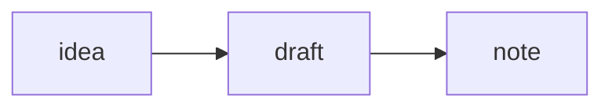

# Note bodies

This specification defines the markdown that a note's `body` holds, the syntax Zib adds to it, and
the rules for titles and labels that depend on it. It follows
[decision ZIB0009](../decisions/ZIB0009-markdown-dialect-and-parser.md) for the dialect and
[decision ZIB0005](../decisions/ZIB0005-note-identifiers-and-links.md) for links and titles.

## Dialect

A body is [CommonMark] 0.31.2 with these [GitHub Flavored Markdown][gfm] (GFM) extensions:

- tables;
- task list items;
- strikethrough, with `~~`;
- extended autolinks, which turn bare web addresses into links.

Zib adds wikilinks, embeds, underlines and highlights, math, diagrams, and list tables, as the
following sections define. Raw HTML parses as CommonMark says, and apps show it as plain text, never
as HTML.

Headings use only the `#` form. CommonMark's setext headings, which underline a line of text with
`=` or `-`, don't exist in Zib: a reader treats the underline as CommonMark would if setext headings
didn't exist. A line of `=` continues the paragraph as text, and a line of three or more `-` is a
thematic break.

Zib's additions never apply inside code spans, fenced or indented code blocks, or HTML blocks, apart
from the fenced blocks that this specification gives a meaning.

## Wikilinks

A wikilink links to a note by its identifier:

```markdown
[[01k97krzh1fcx9rk9fhsgt1de7]]
[[01k97krzh1fcx9rk9fhsgt1de7|a label of my own]]
```

- **Parts.** The target is the text between `[[` and the first `|` or `]]` that a backslash doesn't
  escape. The label, if present, is the text between that `|` and the `]]`.
- **Escapes.** Inside the brackets, `\\`, `\]`, and `\|` stand for a backslash, a `]`, and a `|`
  alone. A backslash before any other character is a backslash.
- **White space.** Readers remove white space from both ends of the target and the label, and then
  the escaping backslashes. Neither part may hold a line break.
- **Targets.** A target is an identifier, in any form that the
  [identifiers specification](identifiers.md#text-form) lets readers accept, optionally followed by
  `#` and a fragment. Writers write the canonical form. Text in brackets whose target isn't an
  identifier isn't a wikilink, and shows as written.
- **Fragments.** This specification reserves fragments and gives them no meaning yet. A reader that
  doesn't understand a fragment links to the whole note.
- **Labels.** A label is inline markdown, and can hold span formatting: emphasis, strong emphasis,
  strikethrough, underlines, highlights, code spans, and inline math. Links and embeds inside a
  label show as their text.
- **Not a wikilink.** Brackets inside code, or with their first `[` escaped by a backslash, aren't a
  wikilink.

A wikilink whose target the machine doesn't hold shows as a link to a missing note. One whose target
has a tombstone shows the tombstone's title, styled as deleted.

## Embeds

An embed is a wikilink with `!` before it, and shows its target in place:

```markdown
![[01k97krzh1fcx9rk9fhsgt1de7]]
```

It follows every rule for wikilinks. Its label, if any, serves as the caption of the embed and as
its alternative text. The [built-in types specification](built-in-types.md#embeds) says how each
type shows.

## Underlines and highlights

Runs of `=` mark underlined and highlighted text:

- `=this=` underlines "this."
- `==this==` highlights "this."
- `===this===` underlines and highlights "this."

The marks follow these rules:

- **Pairs.** A run of `=` opens and closes by the same rules as a run of `*` for emphasis in
  CommonMark: it opens when it's left-flanking, and closes when it's right-flanking. `a = b` stays
  text, but `x=5 and y=6` underlines "5 and y."
- **Escapes.** `\=` stands for a literal `=`, as a backslash escapes any punctuation in CommonMark,
  so `x\=5 and y\=6` stays text.
- **Lengths.** A run closes only a run of the same length, within one block. A run of four or more
  `=` is text.
- **Nesting.** Marks of different lengths nest, so `==a =b= c==` highlights all three words and
  underlines "b."

## Math

Math uses the LaTeX syntax that [KaTeX] accepts.

- **Inline.** `$…$` holds inline math. The opening `$` has no white space after it, and the closing
  `$` has no white space before it and no digit after it, so `$5 and $10` stays text.
- **Display.** `$$…$$` holds display math, which can span lines.
- **Blocks.** A fenced code block whose language is `math` holds display math too.
- **Escapes.** `\$` stands for a dollar sign outside math.

## Diagrams

A fenced code block whose language is `mermaid` holds a [Mermaid] diagram:

````markdown

````

## List tables

A fenced code block whose language is `table` holds a list table, whose cells can hold any markdown.

````markdown
```table header-columns=1
- - Step
  - Notes
- - Install
  - Download the package.

    Then check its signature.
```
````

- **Options.** Options follow `table` on the opening line, separated by spaces, each as
  `name=value`. `header-rows` counts header rows from the top, and defaults to `1`. `header-columns`
  counts header columns from the left, and defaults to `0`. Each value is a decimal number from `0`
  up. Readers ignore options they don't know.
- **Rows and cells.** The block's content is markdown, holding one list. Each item of that list is a
  row, and holds one list of its own, whose items are the row's cells. A cell holds any markdown,
  including a list table of its own.
- **Width.** The table has as many columns as its longest row, and shorter rows end with empty
  cells.
- **Anything else.** A `table` block whose content isn't a list of lists shows as a code block, with
  its content intact.

```abnf
table-info    = "table" *( 1*SP option ) *SP
option        = option-name "=" 1*DIGIT
option-name   = name                         ; as the schemas specification defines it
```

## Titles

A note's title comes from the first line of its body that holds anything but white space. Readers
skip any blank lines before it, and remove the line's leading white space.

- **Heading marks.** Readers remove a leading `#` sequence and the space after it, as a heading
  written with `#` has, and any trailing `#` sequence.
- **Span formatting.** The rest parses as inline markdown, and keeps its span formatting: emphasis,
  strong emphasis, strikethrough, underlines, highlights, code spans, and inline math.
- **Links.** Each link, wikilink, or embed in the line becomes its text: its label, or for a
  wikilink or embed without one, its target's title. A target whose title would come back around to
  a note already on the way shows as its identifier, so titles that link to each other can't loop.
- **Empty.** A note whose body is empty or holds only white space has an empty title, and apps show
  it as untitled.
- **Plain text.** The core also gives each title as plain text, with the formatting removed, for
  places that can only show plain text, such as a window's title or a filename.

## Labels in raw editors

An editor that shows a note's raw markdown fills in labels so the text shows titles, and stores the
text without them:

- **On opening.** When the owner starts editing a note, the editor gives each wikilink without a
  label its target's title, as markdown with its span formatting, escaped as the wikilink rules
  require. It remembers each title it gives each target.
- **While open.** When a target's title changes, the editor replaces each label it gave that target
  with the new title, and remembers that title too.
- **On saving.** The editor removes each label that equals its target's current title or any title
  it gave that target, and keeps every other label as one the owner chose.
- **Edits.** The editor turns each keystroke into the matching edit of the stored text, with the
  filled-in labels left out, so links the owner didn't touch cause no edits. For a change it can't
  map that way, such as a paste over filled-in labels, it applies only the differences between its
  text, with labels removed, and the stored text.

When an editor inserts a wikilink, it stores `[[<id>]]` with the target's canonical identifier. If
the owner selected text first, it stores the text as the label, with each line break replaced by a
space and each backslash, `]`, and `|` escaped.

## Platforms

No platform differs. Every app renders bodies from the core's parse tree.

[commonmark]: https://spec.commonmark.org/0.31.2/
[gfm]: https://github.github.com/gfm/
[katex]: https://katex.org/
[mermaid]: https://mermaid.js.org/
